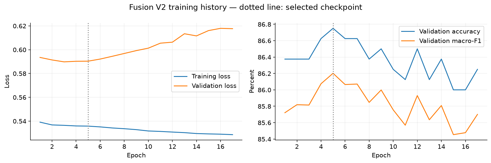
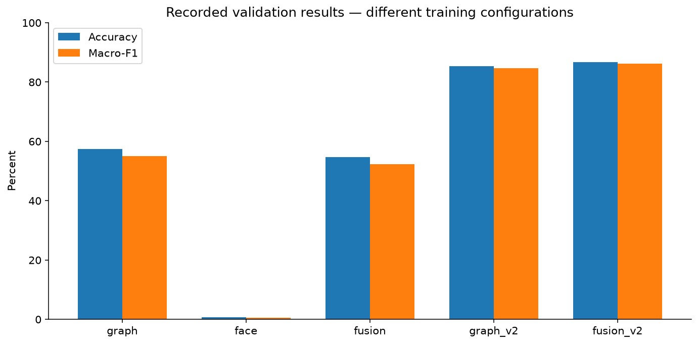
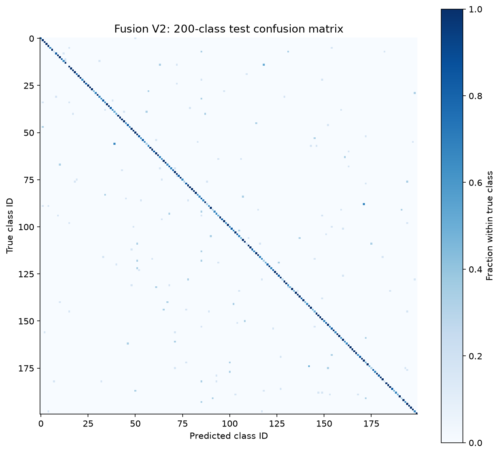
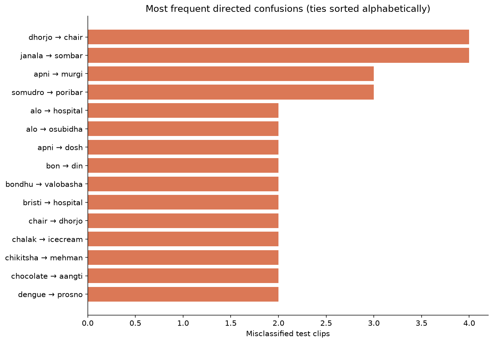
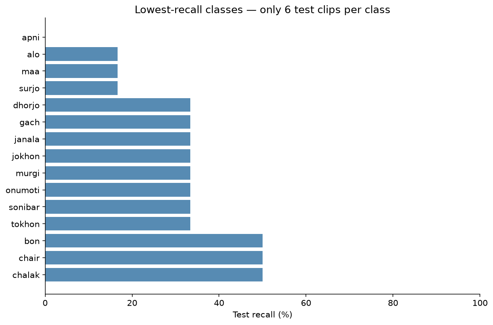

# Evaluation graphs and error analysis

Generated from existing experiment files; no new training or human sign review was performed.

Test: 982/1200 correct (81.83%), 218 incorrect. Macro-F1: 0.8132; top-5 accuracy: 93.33%. Selected checkpoint epoch: 5 (one-based; checkpoint stores a zero-based index).

## Figures

### Training curves

### Validation comparison

### Full confusion matrix

### Frequent confusions

### Lowest recall

## Most frequent errors

- dhorjo predicted as chair: 4 clips.
- janala predicted as sombar: 4 clips.
- apni predicted as murgi: 3 clips.
- somudro predicted as poribar: 3 clips.
- alo predicted as hospital: 2 clips.
- alo predicted as osubidha: 2 clips.
- apni predicted as dosh: 2 clips.
- bon predicted as din: 2 clips.
- bondhu predicted as valobasha: 2 clips.
- bristi predicted as hospital: 2 clips.

## Interpretation and limitations

- Confusion counts identify where to inspect videos; they do not establish why a sign was misclassified. Hand occlusion, timing and similar appearance are hypotheses requiring clip inspection.
- Each class has six test examples, so one error changes class recall by 16.67 percentage points. Low-support rankings are unstable.
- Compare variants on validation metrics. Training configurations differ; this is not a controlled estimate of the face stream alone.
- Training accuracy was not recorded, so only recorded loss and validation curves are plotted.
- The baseline test results were inspected before V2 development. The reused test set is not an untouched final benchmark.
- Offline trimmed-video results do not measure webcam accuracy, unknown-sign rejection or sentence translation.
- Two bilingual meanings remain pending. Classification scores do not validate translations.

## Reproduce

Run `python evaluation/generate_graphs.py` from a checkout containing the recorded results. Requires numpy, pandas and matplotlib. Prediction-derived confusion counts were checked against the saved matrix and reported accuracy.

Prepared with automated analysis assistance. Fardin should review the figures and interpretation before presenting them.
